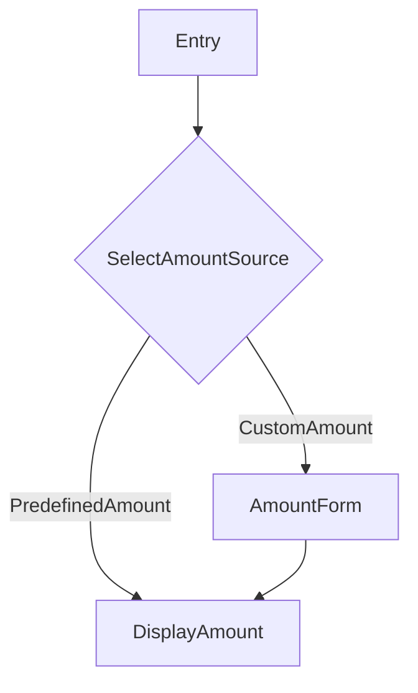
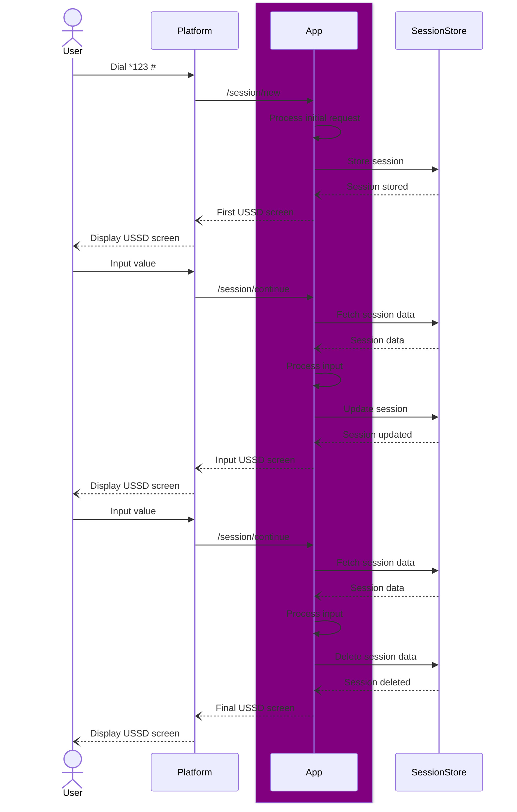
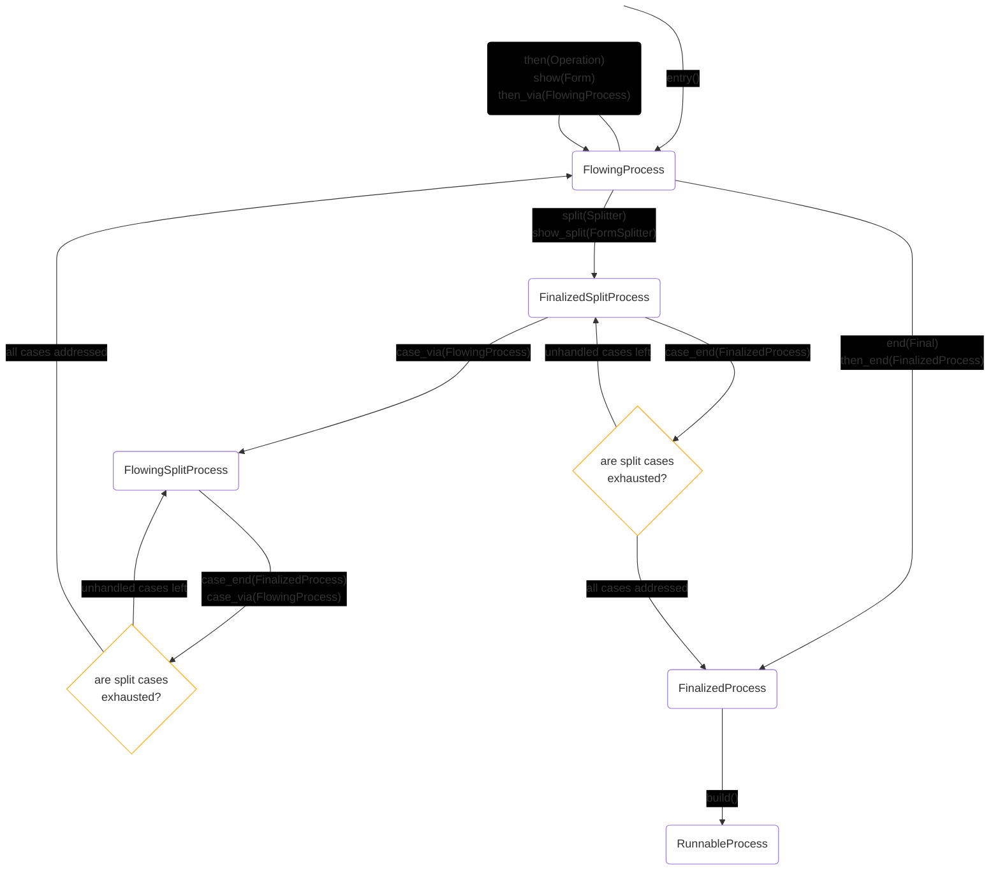

# Brrricks

Type-safe process modelling library

## Core concepts

**Step** is a unit of execution. Each step belongs to one of the
[following archetypes](type_process_builder/src/step.rs): `Entry`, `Operation`, `Form`, `Splitter`, `FormSplitter`, or `Final`.

**Process** is a composition of steps with a defined execution order, including conditional branches and early termination paths.

**Parameter** (param) is a value produced by a step and carried forward across subsequent steps within the same process execution. Same process
execution can span across multiple user interactions.

## Project goals

Process implemented with this library has the following invariants enforced at **compile-time**:

- each step may only consume parameters that are guaranteed to be produced earlier in the process,
- all execution paths must terminate in a final step,
- every branch introduced by a split step must have a corresponding continuation defined,
- once a parameter is produced in any execution path, it cannot be overwritten in subsequent steps.

## Simple explanation

Imagine you're creating a _Choose Your Own Adventure_ book:

> “If you pick A, go to page 5. If you pick B, go to page 10.”

This library is like a guide that helps you build that kind of story in a clear and structured way.<br/>
It helps you organize the steps into a coherent story.<br/>
Thanks to it, you can be confident that your game is logical, complete, and free from certain kinds of issues.

### How is the story built?

* Create a proper introduction. It will be an **entry** point to the story.
* Continue the story using various question **forms** and action **operations**.
* Introduce a **form splitter** to let the reader choose a path, go left or right.
* Face the reader with consequences of their previous actions.<br/>Decide the story continuation path with a **splitter**.
* And at the end, there must always be a proper **final**e!

### What does the tool take care of?

* Nothing appears "out of nowhere". The reader must collect an item or witness something before it is required later in the story.
* Every choice leads somewhere, there are no missing pages.
* Every story always has a proper ending.
* It’s always clear where the reader left off.
* The story can include branching paths and decisions.
* The story won’t require the reader to collect the same item twice unless it is possible to reach that point in the story without it.

### What still needs to be decided?

* What the interaction looks like (what the reader sees and what they respond with)
* What information you want to remember about the user and the system across the interactions (session context)
* Where that information is stored between the interactions

## Code example

The following flowchart illustrates an example process:



The process shown in the flowchart can be implemented using `Brrricks`:
<!-- EXAMPLE_START -->

```rust
#![allow(clippy::unused_async_trait_impl)]
use serde::{Deserialize, Serialize};
use type_process_builder::builder::{FinalizedProcess, FlowingProcess, RunnableProcess, SplitProcess};
use type_process_builder::step::{
  BackToken, Final, Form, FormSplitter, FormWithContext, InputValidation, ProcessMessages, entry,
};
use type_process_builder::{CNil, Coprod, HList, HNil, ToRef, hlist, hlist_pat};
use typenum::{U0, U1};

use type_process_builder::impl_param_value;

#[derive(Deserialize, Serialize)]
pub struct ShortcodeString(pub String);

#[derive(Deserialize, Serialize)]
pub struct Amount(pub u32);

impl_param_value! {
  ShortcodeString => U0,
  Amount => U1,
}

pub struct Messages;
impl ProcessMessages for Messages {
  type FormMessage = String;
  type FinalMessage = String;
}

struct PredefinedAmount;
struct CustomAmount;
struct SelectAmountSource;
impl FormSplitter for SelectAmountSource {
  type CreateFormConsumes = HNil;
  type ValidateInputConsumes = HNil;
  type Produces = Coprod![(PredefinedAmount, HList![Amount]), (CustomAmount, HNil)];
  type Context = EmptyFormContext;
  type Messages = Messages;
  type Error = CNil;

  async fn create_form(
    &self,
    _consumes: <Self::CreateFormConsumes as ToRef<'_>>::Ref,
    back_token: Option<BackToken>,
  ) -> Result<FormWithContext<String, Self::Context>, Self::Error> {
    let string = back_token.map_or("Enter 1 for 100 or 2 for custom amount".into(), |_| {
      "Enter 1 for 100 or 2 for custom amount. 0 to go back".into()
    });
    Ok(FormWithContext(string, EmptyFormContext))
  }

  async fn handle_input(
    &self,
    _consumes: <Self::ValidateInputConsumes as ToRef<'_>>::Ref,
    user_input: String,
    _form_context: Self::Context,
    back_token: Option<BackToken>,
  ) -> Result<InputValidation<Self::Produces, Messages, Self::Context>, Self::Error> {
    Ok(match (user_input.as_str(), back_token) {
      ("0", Some(back_token)) => InputValidation::Back(back_token),
      ("1", _) => InputValidation::Successful(Self::Produces::inject((PredefinedAmount, hlist!(Amount(100))))),
      ("2", _) => InputValidation::Successful(Self::Produces::inject((CustomAmount, HNil))),
      _ => InputValidation::Retry("not 1 or 2".into(), EmptyFormContext),
    })
  }
}

#[derive(Serialize, Deserialize)]
struct EmptyFormContext;

struct AmountForm;
impl Form for AmountForm {
  type CreateFormConsumes = HNil;
  type ValidateInputConsumes = HNil;
  type Produces = HList![Amount];
  type Context = EmptyFormContext;
  type Messages = Messages;
  type Error = CNil;

  async fn create_form(
    &self,
    _consumes: <Self::CreateFormConsumes as ToRef<'_>>::Ref,
    back_token: Option<BackToken>,
  ) -> Result<FormWithContext<String, Self::Context>, Self::Error> {
    let string = back_token.map_or("Enter a number".into(), |_| "Enter a number. 0 to go back".into());
    Ok(FormWithContext(string, EmptyFormContext))
  }

  async fn handle_input(
    &self,
    _consumes: <Self::ValidateInputConsumes as ToRef<'_>>::Ref,
    user_input: String,
    _form_context: Self::Context,
    back_token: Option<BackToken>,
  ) -> Result<InputValidation<Self::Produces, Messages, Self::Context>, Self::Error> {
    if user_input == "0"
      && let Some(token) = back_token
    {
      return Ok(InputValidation::Back(token));
    }
    match user_input.parse::<u32>() {
      Ok(value) => Ok(InputValidation::Successful(hlist![Amount(value)])),
      Err(_) => Ok(InputValidation::Retry("Invalid number".into(), EmptyFormContext)),
    }
  }
}

struct DisplayAmount;
impl Final for DisplayAmount {
  type Consumes = HList![ShortcodeString, Amount];
  type FinalMessage = String;
  type Error = CNil;

  async fn handle(&self, consumes: Self::Consumes) -> Result<String, Self::Error> {
    let hlist_pat!(shortcode_string, amount) = consumes;
    Ok(format!("The amount was: {}. Thanks for dialing: {}!", amount.0, shortcode_string.0))
  }
}

#[must_use]
pub fn build_demo_process()
-> RunnableProcess<impl FinalizedProcess<Messages = Messages, EntryConsumes = HList![ShortcodeString]>> {
  entry()
    .show_split(SelectAmountSource)
    .case_via(PredefinedAmount, |x| x)
    .case_via(CustomAmount, |x| x.show(AmountForm))
    .end(DisplayAmount)
    .build("demo_process", 0)
}

```

<!-- EXAMPLE_END -->

To run the example process in your terminal, execute the following command:

```console
cargo run --example demo
```

## Usage patterns

### Parameters (`impl_param_value!`)

Parameters are serializable values (`#[derive(Serialize, Deserialize)]`) carried in `SessionContext` across steps and user turns. Each parameter type needs a unique type-level `UID` (via `impl_param_value!`) so the compiler can track identity across steps and branches; duplicate `UID`s are caught at compile time:

```rust
impl_param_value! {
  ShortcodeString => U0,
  Amount => U1,
}
```

### Process-scoped error handling

Process-scoped errors are registered per step, accumulated into a deduplicated coproduct `ProcessError<E>` at compile time, and handled at the process scope. Assign each step error type a unique type-level `UID` (`U0` and `U1` are reserved for `SerializationError` and `InvalidStepIndexError`):

```rust
impl_step_error! {
  PaymentError => U2,
}
```

At runtime, inspect them with `err.downcast_ref::<PaymentError>()`, `err.downcast::<PaymentError>()`, or `err.peel()` for exhaustive matching.

### Reusing sub-processes (`then_via` and `then_end`)

Define reusable sub-processes with `entry::<Consumes, Messages>()` and concrete `impl FlowingProcess<...>` or `impl FinalizedProcess<...>` return types:

```rust
fn confirm_amount() -> impl FlowingProcess<
  EntryConsumes = HList![Amount],
  SubprocessConsumes = HList![Amount],
  Messages = Messages,
  Produces = HList![Confirmed, Amount],
  EverProduced = HList![Confirmed, Amount],
  Errors = LibraryErrors,
> {
  entry::<HList![Amount], Messages>().show(ConfirmForm)
}
```

Compose them into any flow that has produced `Amount` using `.then_via(confirm_amount())` or `.then_end(final_sub())` — `Amount` is extracted automatically and only `Confirmed` is merged back in.

### Running a `RunnableProcess`



Start a session with `PreviousRunYieldedAt(StepIndex::MIN)` and serialized `Entry` parameters, then handle `RunOutcome`:

- `RunOutcome::Yield(msg, session_ctx, yielded_at, form_ctx)`: display `msg` and persist `(session_ctx, yielded_at, form_ctx)` (plus a `BackToken` history stack if you support back navigation) for the next user turn.
- `RunOutcome::RetryUserInput(msg, new_form_ctx)`: display `msg` and keep the same `session_ctx` and `yielded_at`, replacing `form_ctx` with `new_form_ctx`.
- `RunOutcome::Back`: pop the previous step's saved `(session_ctx, yielded_at, form_ctx, back_token)` and call `resume_run` again.
- `RunOutcome::Finish(msg)`: display `msg` and close the session.

See [demo/main.rs](type_process_builder/examples/demo/main.rs) for a minimal CLI loop, or [qrios_api_process_runner](examples/qrios_api_process_runner/src/lib.rs) and [qrios_api_axum_server](examples/qrios_api_axum_server/src/lib.rs) for an HTTP + session-store implementation of the interaction flow shown above.

## Process builder states



## Plausible use cases

Built for stateful, turn-based flows such as USSD services:

[Africa's Talking API Reference](https://developers.africastalking.com/docs/ussd/handle_sessions)

[Qrios API Reference](https://deep.qrios.com/api/doc/developer-guide/sdk/ussd)

## Development setup

The following [xtask](https://github.com/matklad/cargo-xtask) installs [monk](https://github.com/daynin/monk) to handle git hooks and updates
autogenerated files.

To run `xtask` in your terminal, execute the following command in the repository root directory:

```shell
cargo xtask
```

Some integration tests require Docker to be running on your machine to start containers for external dependencies (e.g., Postgres).

[//]: # (Redirect can be implemented with a Final step.)

[//]: # (ReturnFromRedirect can be implemented with a Form step.)

[//]: # (Prevent going back from a given step by never returning Back from it. You don't need types for this.)
